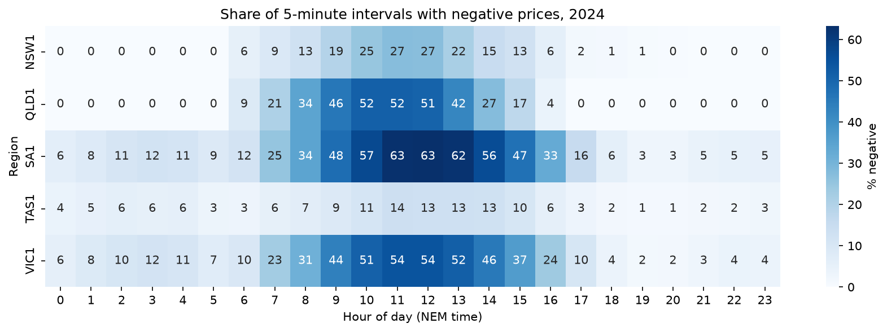

# Negative electricity prices in the NEM
> **Status:** In progress. Current stage covers 2024 price patterns; multi-year trends and generation drivers are next.

Project to investigate when NEM has negative prices

## Key finding - Negative prices for NEM in 2024

In 2024, more than half of midday 5-minute intervals in South Australia, Victoria and Queensland had negative wholesale electricity prices. South Australia peaked at 63%: for example, 63% of all 5-minute intervals between 12:00 and 13:00 had a negative price.



*Each cell shows the percentage of 5-minute intervals in that hour (across all of 2024) with a negative price. Times are NEM time (AEST, no daylight saving).*

## Observations

- **Negative prices peak in the middle of the day, but the size of the peak varies widely by region.**
  - South Australia: highest, above 55% from 10:00 to 15:00, peaking at 63%
  - Victoria and Queensland: peaks of around 52–54% between 10:00 and 13:00
  - New South Wales: lower, peaking at 27% between 11:00 and 13:00
  - Tasmania: lowest, peaking at 14% between 11:00 and 12:00
- **The timing of the peak differs between regions.** Queensland's window starts and ends earliest and South Australia's latest. Because all regions use the same clock, this may reflect the sun's position.
- **South Australia and Victoria also see negative prices overnight**, in up to 12% of intervals between midnight and 05:00, when there is no solar generation.

## Open questions and next steps

- What drives these patterns? The midday peak suggests solar generation and the overnight peak suggests wind, but this needs testing against generation data by fuel type.
- Does the pattern change by season? This heatmap combines the whole year.
- How has it changed over time? Extending the analysis to multiple years will show whether negative prices are becoming more common.
- How often do prices reach the market price cap and floor? These limits are reset each financial year, so comparisons across years need to use each year's values.

## Data

- **Source:** AEMO NEMWEB, MMSDM (Market Management System Data Model) archive, `DISPATCHPRICE` table, retrieved with [nemosis](https://github.com/UNSW-CEEM/NEMOSIS)
- **Period:** 1 January – 31 December 2024, five regions (NSW1, QLD1, SA1, TAS1, VIC1)
- **Fields used:**
  - `SETTLEMENTDATE`: end time of each 5-minute interval
  - `REGIONID`: NEM region (QLD1, NSW1, TAS1, SA1, VIC1)
  - `RRP`: regional reference price ($/MWh)
  - `INTERVENTION`: flag for AEMO market intervention; intervention intervals are excluded to avoid double-counting

## Method

1. `src/load_prices.py` downloads the raw AEMO data with nemosis, filters out intervention intervals, and loads the result into a DuckDB database.
2. `sql/negative_by_hour.sql` calculates the share of negative-price intervals for each region and hour of day. Intervals are assigned to the hour in which they start.
3. `notebooks/01_negative_prices.ipynb` runs the query and produces the heatmap.

## How to reproduce

```
git clone https://github.com/Nicholas-TTTran/NEM-negative-prices
cd NEM-negative-prices
python -m venv .venv
.venv\Scripts\activate        # Windows (Mac/Linux: source .venv/bin/activate)
pip install -r requirements.txt
python src/load_prices.py
```

Then open the notebook and run all cells. The first run downloads AEMO data, which takes a few minutes.

## Tools

Python (pandas, seaborn), SQL (DuckDB), nemosis

## Author

Nicholas Tran